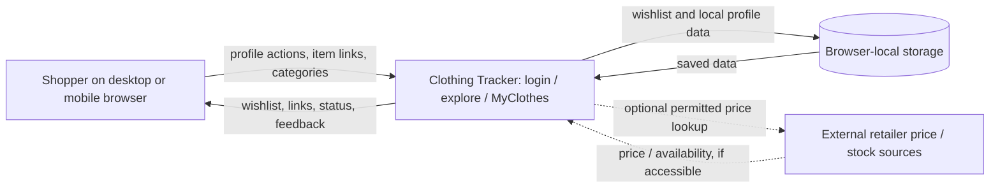

# Full Spec: Clothing Tracker

**Team:** Kendall Atkins, Maimuna, Buraporn, Kendall Van Beveren  **Date:** 2026-11-19  **Committer:** Kendall Atkins: confirm designated committer

**Roles:** Product Owner Kendall Atkins | Process lead Maimuna | Architect Buraporn | Quality lead Kendall Van Beveren | Prompt engineer Maimuna

---

## 0. The idea (Chapter 1)

- **Single main problem and user:** People who browse clothing online need one browser-accessible place to save clothing links, organize items, and review price and availability information without repeatedly visiting each retailer.
- **Who is harmed if the app fails, is wrong, or leaks data?** Users could lose saved wishlists, rely on outdated or incorrect prices or stock status, or have browsing preferences exposed to someone using the same browser or device. Retailers could be affected by excessive automated requests if price retrieval is implemented irresponsibly.
- **What the app must never do:** Store personally identifiable information (per brief); represent unverified prices as live; claim that local-only profiles provide secure online authentication; transmit wishlist data without disclosure; bypass retailer access restrictions or terms.
- **AI contribution:** AI translated the brief into a problem statement and identified risks; no new capabilities were treated as confirmed requirements.

## 1. Process and plan (Chapters 2 and 3)  Owner: Maimuna

- **Proposed process model:** Incremental development is a good fit because the three Must-do capabilities can be delivered and verified before attempting uncertain retailer integrations. Short feedback cycles will expose browser-storage and price-access limitations early, without requiring the entire wishlist application to be built at once.
- **Proposed practices (confirm with team):** Short weekly stand-up, task board, three short sprints, code review for merges, automated tests on each change, and a retrospective at the end of each sprint.
- **Definition of Done (proposed):**
  - [ ] Feature meets its documented acceptance criteria.
  - [ ] Core logic is separated from display code and has passing unit tests.
  - [ ] Feature works in a desktop and mobile browser viewport.
  - [ ] Local data persists across a page reload where applicable.
  - [ ] No personal identifying information is collected or stored.
  - [ ] Changes are reviewed, documented, and merged with tests passing.
- **Sprint plan (proposed):**

| Sprint | Working software at the end | se-agent run? |
|---|---|---|
| 1 | Three-page navigation, local profile concept, basic item entry and saving | Proposed: yes, after Run Brief review |
| 2 | MyClothes list with category/folder organization, persistence, and automated tests | Proposed: yes |
| 3 | Responsive and accessible interactions; explore page; feasibility prototype for price display/comparison only if access is available | Proposed: yes |

- **Biggest schedule risk:** Live retailer price/stock retrieval may be blocked or require an external service, conflicting with the no-backend constraint. **Mitigation:** validate one retailer-access path before committing to automatic updates; retain manual item links and clearly labeled prices as the fallback; obtain a team decision before changing scope.
- **AI contribution:** AI proposed an incremental process, sprint deliverables, and risk mitigation; team must confirm dates, practices, and agent runs.

## 2. Requirements (Chapter 4)  Owner (Product Owner): Kendall Atkins

### Stakeholders and what each wants

| Stakeholder | Wants |
|---|---|
| Clothing shopper / wishlist owner | Save item links, find items again, and organize by type or style |
| Shopper using desktop or phone browser | Access a usable interface on different screen sizes |
| User with accessibility needs | Adjustable text size, usable icons/images, and access to text-to-speech support |
| Development team | Testable scope compatible with three static HTML pages and local storage |
| Retailer / external price source | Requests that respect access rules; accurate attribution if prices are shown |
| Course evaluator / se-agent workflow | Traceable Must-do requirements, tests, Run Brief, and documented decisions |

### User stories and acceptance criteria

1. **As a shopper, I want a local user profile with no login, so that I can access my clothing list.** Acceptance: creating a profile and using the supported entry flow opens MyClothes. 
2. **As a shopper, I want to save a clothing item and its retailer link, so that I can revisit it later.** Acceptance: after saving a valid item, it appears in MyClothes and remains after reloading the page.
3. **As a shopper, I want to assign saved clothing to a folder or category, so that I can find it by item type or style.** Acceptance: selecting a category displays the items assigned to it.
4. **As a shopper, I want to view price information for an item, so that I can evaluate its cost.** Acceptance: if price data is available, the UI shows the amount, seller, and whether it is verified/current or manually entered.
5. **As a shopper using a phone or assistive technology, I want readable and accessible controls, so that I can use my wishlist.** Acceptance: the three pages support narrow viewports, keyboard operation, meaningful labels, and enlarged browser text, native bowser/device tect-to-speech is sufficient.

### Requirements table

| ID | Type | Requirement (testable sentence) | Priority | Acceptance test (input → expected result) |
|---|---|---|---|---|
| R1 | F | The app shall let a user create a local profile and enter a profile-specific MyClothes view using a documented local login-style flow. | Must | Create local profile, select/enter it → MyClothes opens 
| R2 | F | The app shall save a clothing item with a name and valid retailer URL to browser-local storage and display it in MyClothes after reload. | Must | Save `Jacket` with valid HTTPS URL; reload → item and link remain visible. |
| R3 | F | The app shall let users assign saved items to a category or folder and display items filtered by that grouping. | Must | Save two items in different categories; select one category → only matching items display. |
| R4 | NF (performance) | The app shall load the local wishlist without requiring a network request to retrieve locally saved items. | Should | Disconnect network after loading app; reopen MyClothes in the same loaded session → local items render. Load time target should be under 3 seconds.
| R5 | NF (usability/accessibility) | The three pages shall support keyboard navigation and browser text enlargement without hiding core controls. | Must | Navigate controls using keyboard and zoom to 200% → save and organization actions remain usable.
| R6 | NF (privacy) | The app shall store wishlist/profile data locally and shall not request or store personally identifiable information. | Must | Inspect form fields, storage, and app requests → no name, email, address, or other PII required, pseudonymous profile identifier is allowed. |
| R7 | NF (cost) | Any AI feature, if introduced, shall cost less than $0.01 per use. | Should | Estimate measured usage cost for an AI invocation → less than $0.01. No AI feature is currently required. |
| R8 | F | The app should display price information associated with saved items when a permitted source is available, with its source and freshness indicated.
| R9 | F | The app should alert the user when an item's selected size returns to stock. | Should | Simulate stock change → alert displayed the alert should be a notification in the app;
| R10 | F | The app should alert the user when an item's price decreases. | Should | Simulate price decrease → alert displayed; Notifications should be in the app when an item is clicked.
| R11 | F | The app should compare available prices from multiple sellers for the same item. 

### Out of scope

- Password encryption, device-to-device synchronization, and clothing recommendations, as explicitly listed in the brief.
- **Conflict:** The brief also lists clothing recommendations as a Should-do; **proposed resolution** is to keep recommendations out of scope until the Product Owner decides otherwise.
- **Not assumed:** secure server-side accounts, cloud data storage, background monitoring, and push notifications; these are not supported by the stated static-site architecture.

### Requirements removed or deferred as unnecessary, and why

- **Proposed deferral:** Recommendations do not support the three primary Must-dos and conflict with the brief's out-of-scope list.
- **Proposed deferral:** Cross-device synchronization and password-based security would require a different architecture and privacy model.


### Open questions

1. Does “login” mean a local profile selector, a local PIN, or genuine authenticated accounts? How can it comply with “no backend” and “no PII”?
2. Is displaying prices from multiple sellers a Must-do (because it appears in acceptance criteria) or a Should-do?
3. What approved retailer APIs, feeds, or user-supplied data sources are available? Can browser CORS and retailer policies be satisfied?
4. Are prices expected to update automatically, on page open, or only on manual refresh? What does “live” mean?
5. Is clothing recommendation functionality in or out of scope?
6. What accessibility standard and text-to-speech implementation are required?
7. What exact performance target and browser support matrix are required?
8. How are local profiles separated when multiple people use the same device?

- **AI contribution:** AI formalized the brief's capabilities into testable requirements and surfaced conflicts; no disputed priority was silently decided.

## 3. Models (Chapter 5)  Owner (Architect): Buraporn

### Context model



**Inside boundary:** HTML/CSS/JavaScript for three pages, local profile flow, item management, grouping, and display logic. **Outside boundary:** browser storage service, retailers, and any future third-party AI service. External retailer data can be accessed directly from the browser.

### Use case / sequence for saving an item

1. User enters or selects a local profile (R1).
2. User opens Explore or MyClothes and chooses to add an item.
3. User enters a clothing name, retailer URL, and optional category (R2–R3).
4. Input validation checks required fields and URL format.
5. The item service writes a record to browser-local storage.
6. MyClothes reads the stored records and displays the new item.
7. User reloads the page; the saved item remains visible.
8. On invalid input or storage failure, the app displays an error rather than claiming the save succeeded.

### Class / data model (proposed)

- **LocalProfile:** `id` (local pseudonymous identifier), `displayLabel` (optional, non-PII), `createdAt`;
- **ClothingItem:** `id`, `profileId`, `name`, `url`, `categoryId`, `createdAt`; optional `size`, `imageUrl`.
- **Category:** `id`, `profileId`, `label`; one category can contain many clothing items.
- **PriceObservation (optional):** `itemId`, `seller`, `amount`, `currency`, `observedAt`, `source`, `verificationStatus`; zero or more observations per item.
- **StockObservation (optional):** `itemId`, `size`, `availability`, `observedAt`, `source`.
- Relationship: one local profile has many clothing items and categories; a clothing item belongs to a profile and may belong to one category; observations are optional and associated with items.

### State model

- **App navigation:** `Login` → `Explore` or `MyClothes`; `Explore` ↔ `MyClothes`.
- "logged in "means selected local profile
- **Item save:** `Editing` → `Validating` → `Saved` or `Error`.
- **Optional price status:** `Not checked` → `Loading` → `Available` / `Unavailable` / `Error` / `Stale`.

### Consistency check

- R1–R3 map to profile, item, category entities and the save sequence.
- R5–R6 map to UI and storage boundaries; R7 applies only if an AI service is added.
- R8–R11 map to optional observations and retailer integration; they must not become required implementation work without a scope decision.
- **AI contribution:** AI proposed context, data, sequence, and state models from the brief; optional entities are clearly marked.

## 4. Architecture (Chapter 6)  Owner (Architect): Buraporn

- **Proposed pattern:** Layered client-side architecture: three HTML pages and view controllers → domain/service functions → browser-local persistence adapter. An optional price-provider adapter sits behind an interface rather than inside UI code.
- **Non-functional drivers:** R4 (local availability/performance), R5 (accessible browser UI), R6 (local data/privacy), and R7 (AI-cost ceiling if used).
- **Alternatives rejected or deferred (proposed):** Server-backed authentication and cloud database conflict with the no-backend constraint; a framework requiring a build step conflicts with the no-build constraint; direct hard-coded scraping of retailer pages is unreliable and may be prohibited.
- **AI model:** No AI model is required for the three Must-dos. If later used for recommendations, the feature must remain optional, fail gracefully, and meet R7 (<$0.01 per use). **Cost per use:** Will be calculated by the hugging face cost.
- **Price retrieval fallback:** If retailer data is slow, incorrect, inaccessible, or blocked, display the saved retailer link and a clearly labeled unavailable/stale price; do not invent a current price.

### Decisions log

| # | Decision | Alternatives | Reason (R-number) | Consequence |
|---|---|---|---|---|
| D1 | **Proposed:** three static HTML pages with plain JavaScript and no build step | SPA framework, server-rendered app | Brief constraint; R4, R5 | Simple deployment; limited integration options |
| D2 | **Proposed:** browser-local storage behind a persistence module | Cloud database, server session | R2, R6 | No cross-device sync; shared-browser privacy considerations |
| D3 | **Proposed:** optional price-provider adapter with explicit unavailable state | Embedded retailer scraping, hard-coded “live” prices | R8, R11 and data-access uncertainty | Price features may be deferred; core wishlist remains functional |

- **AI contribution:** AI proposed an architecture aligned with stated constraints and documented tradeoffs; no architecture decision is represented as team-approved.

## 5. Design and implementation (Chapter 7)  Owner: Kendall Van Beveren

### Modules and owners

| Module | Owner | Responsibility |
|---|---|---|
| `login.html` and `login.js` | Kendall Atkins | Local profile creation/selection and entry flow (R1) |
| `explore.html` and `explore.js` | Maimuna | Item discovery/entry and optional price presentation |
| `myclothes.html` and `myclothes.js` | Buraporn | Saved-item list and category/folder interface (R2, R3) |
| `itemService.js` | Kendall Van Beveren | Validate and manipulate clothing records without DOM dependencies |
| `categoryService.js` | Buraporn | Category assignment and filtering |
| `profileService.js` | Kendall Atkins | Local profile rules; 
| `storageAdapter.js` | Kendall Van Beveren | Read/write local data, handle malformed or unavailable storage |
| `priceProvider.js` (optional) | Maimuna | Normalize permitted external price/stock data; report unavailable/stale data |
| `styles.css` | Kendall Atkins | Responsive layout, text scaling, focus visibility, icons/images |
| `tests/` | Kendall Van Beveren | Unit tests and browser-level acceptance checks |

- **Logic apart from display:** Validation, CRUD operations, grouping/filtering, and price-data normalization belong in pure functions or services; HTML event handlers only collect input, call services, and render results.
- **Design patterns (proposed):** Repository/adapter for storage, provider adapter for external price sources, and simple separation of view from domain logic. No additional patterns required yet.
- **Code/libraries to reuse and licenses:** Browser Web APIs (DOM, `localStorage`) require no third-party dependency.
- **Branching/review rule (proposed):** Feature branches, pull request review by one other team member, passing tests before merge.
- **Known technical debt:** Local-only identity is not secure authentication; browser storage may be cleared; automatic retailer updates are unresolved; no device synchronization; price history may be incomplete. These limitations must be disclosed in the UI/documentation.
- **AI contribution:** AI suggested a modular design and isolated business logic to support the brief's unit-testability requirement; module names are provisional.

## 6. Testing (Chapter 8)  Owner (Quality lead): Kendall Van Beveren

### Requirement-to-test map

| Requirement | Test (proposed file::name) | Type | How we will check it can fail |
|---|---|---|---|
| R1 | `tests/profile.test.js::creates_and_enters_local_profile` | Unit + system | Remove profile persistence/selection logic; expected test fails |
| R2 | `tests/items.test.js::saves_item_and_restores_after_reload` | Unit + system | Disable storage write or URL validation; expected test fails |
| R3 | `tests/categories.test.js::filters_items_by_category` | Unit + component | Return all items regardless of category; expected test fails |
| R5 | `tests/accessibility.test.js::keyboard_and_zoom_controls_usable` | User/system | Remove focus access to Save; keyboard test fails; inspect at 200% zoom |
| R6 | `tests/privacy.test.js::does_not_collect_pii` | Component/system | Add required email field or PII storage; expected test fails |

**Note:** Test file names are planned, not existing or executed. R4, R7–R11 require tests if their corresponding features are implemented.

### Three most important tests (input → expected result)

1. **Profile entry (R1):** Create a local profile and select/enter it → its MyClothes view opens, with no required PII;
2. **Item persistence (R2):** Enter an item name and valid retailer URL, save, reload → item and link still appear in MyClothes.
3. **Category organization (R3):** Save a shirt under “Tops” and shoes under “Shoes”; filter “Tops” → shirt appears and shoes do not.

- **Edge cases:** R1: empty/duplicate local identifiers, missing profile, cleared storage, different profiles on one browser; R2: empty name, empty/invalid URL, very long URL, duplicate links, storage quota error; R3: no categories, empty category, duplicate category labels, deleted category, many items; R5: keyboard-only navigation, 200% zoom, small viewport; R6: inspect browser storage and network requests for PII.
- **User testing:** TODO: recruit at least one person outside the team who regularly saves clothing links, and ideally a keyboard-only or screen-reader user; observe whether they can create/enter a profile, save an item, and locate it by category without guidance.
- **Not testing (initially):** Live stock alerts, retailer price comparison, and recommendations unless approved and implemented; cross-device synchronization and password security are out of scope. Do not claim real retailer prices are verified without a permitted data source.
- **Test command:** `TODO: select and install a JavaScript test runner; e.g., npm test if one is adopted`. Course preflight also requires `uv run pytest`; **TODO:** determine whether repository-provided Python tests exist and run that command separately. No tests have been run as part of this document draft.
- **AI contribution:** AI proposed traceable tests and fault-injection checks; the team must implement and run them.

## 7. Evolution (Chapter 9)  Owner: Kendall Atkins

- **Most likely future change:** Adding reliable price/stock updates and alerts, since they are central to the project idea but not part of the three explicit Must-dos.
- **Impact analysis:** Would change R8–R11, the context and observation models, the `priceProvider` adapter, MyClothes/Explore displays, and tests for freshness, failures, and alerts. A backend or scheduled service may become necessary, contradicting current constraints. **Estimated time:**  depends on retailer API availability, rate limits, and architecture approval; do not invent a duration.
- **Design choice to ease change:** Keep price and stock observations separate from the core ClothingItem record and isolate all retailer access behind a provider interface, so local wishlist functionality works without price retrieval.
- **AI contribution:** AI identified a likely evolution path and proposed interface isolation; timing remains unestimated.

## 8. Decisions we are least sure about

1. **Authentication vs privacy and architecture:** A real secure login is not achievable as described with static HTML and no backend.
2. **Automatic price and stock updates:** No approved data source or refresh mechanism is specified; browser CORS restrictions and retailer rules may block implementation.
3. **Priority conflict:** Price comparison is a Should-do but also an acceptance criterion. 
4. **Recommendations conflict:** Listed as both Should-do and out of scope.
5. **Accessibility:** Built-in text-to-speech versus support for browser/OS assistive technology is unclear.
6. **Costs:** Price-provider fees and any AI invocation cost are unknown; the <$0.01 limit applies only to AI features in the brief.

## 9. Run plan and cost (se-agent)  Owner (Prompt engineer): Maimuna

- **Prompts in `prompts/` to use, in order (proposed):** `01-profile-and-navigation.md`, `02-wishlist-and-categories.md`, `03-accessibility-and-price-feasibility.md`. **TODO:** create actual prompt files, confirm filenames, and ensure each uses the required eight-section prompt structure.
- **Model:** `gpt-6-luna` for iteration, per template; ask before using a stronger model.
- **Planned runs (proposed: one per sprint):**

| Run | Sprint | Prompts | Model | Estimated cost (`uv run python cost_estimate.py docs/RUN_BRIEF.md`) |
|---|---|---|---|---|
| 1 | 1 | `01-profile-and-navigation.md` | `gpt-6-luna` | TODO: run estimator |
| 2 | 2 | `02-wishlist-and-categories.md` | `gpt-6-luna` | TODO: run estimator |
| 3 | 3 | `03-accessibility-and-price-feasibility.md` | `gpt-6-luna` | TODO: run estimator |

- **Preflight (not yet verified):**
  - [ ] `uv run pytest` passes in the project repository.
  - [ ] `docs/RUN_BRIEF.md` is 4,000 characters or fewer.
  - [ ] Each agent prompt follows the eight-section template.
  - [ ] Model and estimated run costs have been reviewed by the team.
- **AI contribution:** AI suggested a three-run sequence; no agent runs, cost estimates, or tests were executed.

## 10. Run Brief

The Run Brief is a **separate file** at `docs/RUN_BRIEF.md`. It is what se-agent reads, and it must be **4,000 characters or fewer**. The agents do not read this Full Spec.

- **Source for Run Brief:** The uploaded `BRIEF_TEMPLATE.md` contains the current project brief. Copy it to `docs/RUN_BRIEF.md` after removing instructional quote lines and resolving contradictory scope items.
- **Keep:** Main clothing-wishlist problem, browser users, R1–R3 Must-dos, three static HTML pages/no backend/no build step, browser-local data, no PII, AI cost ceiling, out-of-scope items, and acceptance checks.
- **Cut:** Process reasoning, stakeholder table, models, decision log, and detailed testing discussion; those remain in this Full Spec.
- **Translate:** Local storage and privacy become explicit constraints; the layered design becomes a one-sentence architecture description; tests become observable acceptance checks.
- **Characters in current uploaded brief:** TODO: check the final copied and edited `docs/RUN_BRIEF.md`, not merely the upload.
- **What we cut to fit and why safe:** TODO: record actual edits once the final Run Brief is prepared. Removing template instructions is safe because they are guidance to authors, not application behavior.
- **Length check:**

```bash
python -c "print(len(open('docs/RUN_BRIEF.md', encoding='utf-8').read()))"
```

- **AI contribution:** AI identified what to retain and defer; the final Run Brief has not been created or measured here.

## 11. Presentation notes (six beats; every member speaks)

| Beat | Who | One sentence we will say |
|---|---|---|
| 1. Problem, user, Must-dos (Ch 4) | Kendall Atkins | “Clothing Tracker helps shoppers save and organize retailer links through a local profile, item storage, and categories.” |
| 2. Process choice and Definition of Done (Ch 2, 3) | Maimuna | “We propose incremental delivery, completing and testing the three Must-dos before attempting uncertain price integrations.” |
| 3. Context model and one more model (Ch 5) | Buraporn | “The browser app stores profile, item, and category records locally, while external retailer data remains an optional integration.” |
| 4. One architecture decision: chosen, rejected, requirement (Ch 6) | Buraporn | “A layered static-client design supports local storage and privacy (R4, R6) without introducing a backend.” |
| 5. Three most important tests and how we know they can fail (Ch 8) | Kendall Van Beveren | “We will test profile entry, item persistence, and category filtering, then deliberately break their logic to verify that the tests catch failures.” |
| 6. Likely change, Run Brief, cost plan (Ch 9, 4) | Maimuna | “Price and stock updates are the likely next change; we will isolate their integration and estimate se-agent costs before each planned run.” |

- **AI contribution:** AI drafted six presentation talking points; team must assign speakers and revise them to reflect actual decisions and completed work.
